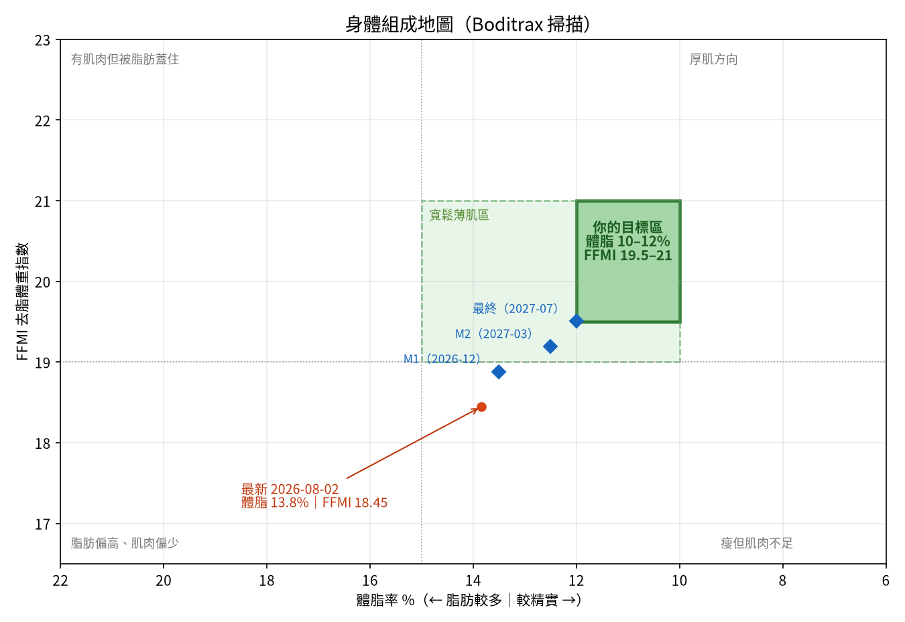

# 薄肌＋垂直跳躍 訓練追蹤手冊

> 用法：每次訓練在 **LeanLog 網頁**上用點選記錄（不用打字），網頁會自動算容量、有效組數、跟上次比較。想要更深入的建議時，跟我說「週報」或「幫我看一下」，我會把資料匯出來跑分析、給調整建議。

---

## 1. 這套系統怎麼運作

| 你做的事 | 頻率 | 會得到什麼 |
|---|---|---|
| 網頁「今天」點訓練日開始，逐組打勾、按結束 | 每次訓練 | 網頁立即顯示：本次容量、有效組數、PR、與上次同動作比較 |
| 網頁「今天」點排球，選類型、時長、強度、跳躍量、膝蓋 | 每次打球 | 自動算進跳躍量，隔天建議多休一天 |
| 網頁「身體」記早上空腹體重（選填） | 越常越好 | 7 日平均趨勢；判斷熱量吃得夠不夠 |
| 網頁「身體」輸入 Boditrax 掃描，或把照片傳給我代為輸入 | 每 4 週 | 身體組成地圖更新、里程碑進度 |
| 網頁「身體」記摸高測試 | 每 2–4 週 | 摸高進度、推估跳躍高度 |
| 跟我說「週報」 | 每週一次 | 我匯出資料跑完整分析：各肌群組數、訓練負荷、跳躍量、調整建議 |

資料存在網頁的雲端資料庫。我分析時用 `pnpm export:manus --out analysis/data` 匯出成 `analysis/data/` 的 CSV，再在 `analysis/` 裡跑 `python3 tracker.py report`；你自己也可以在網頁「設定 → 匯出給 Manus 分析」一鍵複製，貼到對話裡。

---

## 2. 你的基準分析（Boditrax，2026-08-02）

| 項目 | 數值 | 解讀 |
|---|---|---|
| 體重（掃描推算） | 68.6 kg | 脂肪 9.5 ＋ 去脂 59.1。比你說的空腹 70–71 kg 輕 2 kg 左右，**需要確認掃描當天是否空腹** |
| 體脂率 | **13.8%** | 已經在寬鬆的薄肌範圍（10–15%），但要看到明顯腹肌線條，通常要到 10–12% |
| 去脂體重 FFM | 59.1 kg | 包含肌肉、骨骼、水分 |
| FFMI | **18.45** | **這是你目前最大的缺口**。18–19 大約是一般沒有系統訓練的水準；薄肌目標是 19.5 以上 |
| 內臟脂肪 | 5 | 很健康 |
| 腿部肌肉：左／右 | 10.1／10.2 kg | 左右非常平均（差 1%），對跳躍是好事 |
| 手臂肌肉：左／右 | 2.9／3.2 kg | 右手多約 10%，很可能是扣球手，排球員常見，不算問題 |
| 脂肪分布 | 軀幹 4.7 kg，約佔全身一半 | 正常分布；腹部脂肪通常最後才掉，所以腹肌會在 10–12% 附近才明顯 |

**一句話診斷：你不需要減肥，你需要長肌肉。** 體脂已經接近目標，真正的差距在肌肉量。

> 注意：Boditrax 的「Muscle Mass 56 kg」跟 InBody 的「骨骼肌重」定義不同，數字不能互相比較。之後請**固定用同一台 Boditrax**，在相同條件下量測。



---

## 3. 目標定義

### 3.1 薄肌目標

| 指標 | 現在 | 目標 | 差距 |
|---|---|---|---|
| 體脂率 | 13.8% | 10–12% | −1.8 到 −3.8 個百分點 |
| FFMI | 18.45 | 19.5–21 | +1.05 |
| 去脂體重 | 59.1 kg | ≥ 62.5 kg | **+3.4 kg** |
| 脂肪量 | 9.5 kg | 約 7.7–8.5 kg | −1.0 到 −1.8 kg |
| 體重 | 68.6 kg | 約 70–71 kg | 跟你現在的空腹體重差不多 |

換句話說：**體重大致不變，把 1–2 kg 脂肪換成約 3 kg 的肌肉**。FFMI 上限設在 21，是為了維持「薄」而不是往厚肌走。

**達標規則**：連續兩次掃描，體脂率和 FFMI 都落在目標區內。

**里程碑（暫定，知道你的訓練年資後會調整）**：

| 里程碑 | 期限 | 去脂體重 | 體脂率 |
|---|---|---|---|
| M1 | 2026-12-31 | ≥ 60.5 kg | ≤ 13.5% |
| M2 | 2027-03-31 | ≥ 61.5 kg | ≤ 12.5% |
| 最終 | 2027-07-31 | ≥ 62.5 kg | ≤ 12.0% |

### 3.2 助跑摸高目標：320 cm

你還沒實測站立摸高，先用一般人比例估算：身高 179 × 1.33 ≈ **238 cm**。目前助跑摸高約 **305 cm**（剛好摸到籃框），推估助跑跳躍高度約 **67 cm**；320 cm 需要約 **82 cm**，也就是再多 **15 cm**。這是有挑戰但合理的目標（一般業餘男生多落在 55–70 cm）。之後實測站立摸高後，在網頁「設定」改掉即可，所有推估會自動更新。

### 3.3 兩個目標的關係

兩個目標大致是**互相幫忙**的：脂肪少一點，身體就輕一點，跳躍所需的相對爆發力就更好；下肢力量增加，也會直接幫助起跳。唯一要避免的是亂增重（大吃增肌），那樣兩個目標都會受傷。

---

## 4. 訓練原則（初版）

排球本身已經給下肢很多跳躍刺激，所以我建議**上下半身的訓練目的分開**：

| 部位 | 主要目的 | 做法 |
|---|---|---|
| 上半身（肩、背、胸、手臂） | **肌肥大**：薄肌的視覺線條主要來自這裡 | 每個肌群每週 10–16 組有效組，6–15 下，接近力竭（RPE 7–9） |
| 下半身 | **力量＋爆發**：提升起跳 | 深蹲／六角槓硬舉／羅馬尼亞硬舉／分腿蹲，3–6 下偏重；加上少量增強式訓練 |
| 核心 | 穩定與線條 | 每週 6–10 組 |

**每週有效組數目標**（系統會自動檢查）：

| 胸 | 背 | 肩 | 二頭 | 三頭 | 核心 | 股四頭 | 腿後 | 臀 | 小腿 |
|---|---|---|---|---|---|---|---|---|---|
| 10–16 | 12–18 | 10–16 | 8–14 | 8–14 | 6–10 | 6–10 | 6–10 | 6–10 | 0–8 |

- **有效組**：RPE 7 以上（大約離力竭剩 3 下以內）的正式組。主要肌群算 1 組，次要肌群算 0.5 組
- **漸進超負荷**：同一個重量，每一組都達到目標次數上限時，下次就加重
- **跳躍負荷管理**：我會追蹤每週跳躍次數（排球＋增強式）和訓練負荷（時長 × 自評強度）。如果比前 3 週平均暴增 30% 以上會提醒你，因為這是跳躍膝（髕骨肌腱）最常出問題的情況

---

## 5. 飲食原則（初版）

| 項目 | 建議 | 說明 |
|---|---|---|
| 蛋白質 | **每天 125–155 g**（1.8–2.2 g/kg） | 長肌肉最重要的一項；如果只想記一項飲食，就記這個 |
| 熱量 | 維持熱量，或多 200–300 kcal | 用去脂體重推估，你的維持熱量大約 2,550–2,850 kcal（看排球量） |
| 體重變化 | 7 日平均每月 **+0.25–0.5 kg** | 增加太快代表吃太多，脂肪會跟著長；完全沒變但力量有進步，也可以接受 |

---

## 6. 量測規範

| 項目 | 頻率 | 條件 |
|---|---|---|
| Boditrax 掃描 | 每 4 週 | 同一台機器、早上、空腹、上完廁所、訓練前；前一天不要做大量腿部訓練或喝酒 |
| 空腹體重 | 越常越好 | 早上起床、上完廁所、進食前，同一台體重計 |
| 站立摸高 | 每 4–8 週 | 赤腳或穿球鞋（每次一樣）、雙腳平貼地面、單手伸直往上摸的最高點 |
| 助跑摸高 | 每 4 週 | 熱身後測 5 次取最佳；不要在練腿的隔天測 |

---

## 7. 備用回報格式（網頁不方便時，直接打給我也可以）

**重訓**

```
10/1 重訓 70分 RPE8
深蹲 80x5x3 @8
引體 BWx8, x7, x6
臥推 60x8x3
側平舉 8kgx15x3
```

**排球**

```
10/2 排球 120分 RPE7 跳約 80 次（練習／比賽）膝蓋 OK
```

**體重**：`10/1 體重 70.4`

**掃描**：直接拍 Boditrax 畫面傳給我（像這次一樣）

**跳躍測試**：`10/5 站立摸高 236 助跑摸高 305`

小提醒：`80x5x3` 代表 80 kg × 5 下 × 3 組，`@8` 代表 RPE 8；引體向上、伏地挺身這類徒手動作，我會自動把體重算進容量。

---

## 8. 檔案結構

網頁（LeanLog）是主要的資料來源，下面這些 CSV 是匯出後給分析程式用的副本。

| 檔案 | 內容 |
|---|---|
| `data/sessions.csv` | 每次訓練（類型、時長、自評強度、跳躍次數） |
| `data/sets.csv` | 每一組（動作、次數、重量、RPE） |
| `data/body_scans.csv` | Boditrax 掃描（含分段肌肉與脂肪） |
| `data/daily_weight.csv` | 每日體重 |
| `data/jump_tests.csv` | 摸高測試 |
| `data/exercises.csv` | 動作對應的肌群清單 |
| `config.json` | 目標、里程碑、每週組數目標（都可以調） |
| `tracker.py` | 記錄與分析程式 |
| `reports/dashboard.md` | 最新儀表板 |
