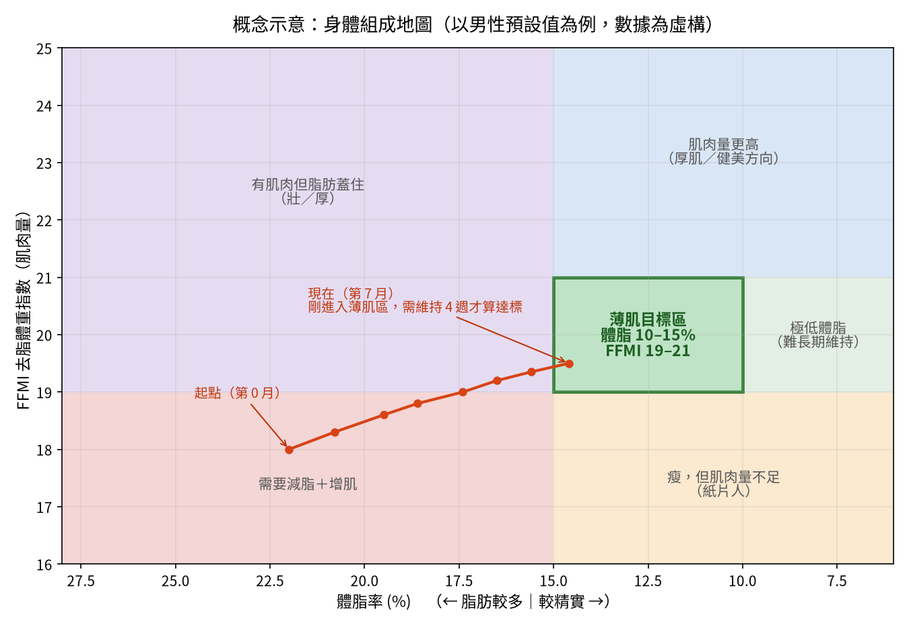

# 薄肌追蹤 App：產品規格草稿 v0.1

> **文件狀態**：討論稿。標示【待決定】的項目需要你拍板，其餘內容都是我先提的預設方案，隨時可以改。

---

## 1. 產品定位

**一句話定位**：一個能回答「**我離薄肌還有多遠、照現在的進度還要多久**」的個人健身追蹤 App。

**要解決的三個痛點**：

| 痛點 | 說明 | App 的解法 |
|---|---|---|
| 「薄肌」很模糊 | 只知道想要「瘦瘦的但有線條」，沒有可以檢查的標準 | 把薄肌拆成幾個可量測指標，組成「目標區」 |
| 體重數字會誤導人 | 增肌減脂的時候體重可能完全沒變，很容易覺得沒進步 | 主要看**體脂率＋肌肉量**這兩個維度，體重只當輔助 |
| 資料散在各處 | 體脂計 App、訓練筆記、手機相簿各放各的 | 身體數據、訓練、進度照集中放在同一個地方 |

---

## 2. 核心概念：把「薄肌」量化

這是整份 spec 最重要的一節，後面所有功能都建立在這個定義上。

### 2.1 薄肌的判定指標（預設值，全部可以自訂）

網路上常見的說法是：薄肌大約對應**男性體脂 10–15%、女性 18–22%**，肌肉線條看得到但不粗壯。問題是光看體脂不夠，「瘦但沒肌肉」的人體脂也可能很低，所以還要加上肌肉量指標 FFMI（去脂體重指數）。

| 指標 | 用來判斷什麼 | 男性預設目標 | 女性預設目標 | 資料來源 | 角色 |
|---|---|---|---|---|---|
| 體脂率 | 線條是否顯現 | 10–15% | 18–22% | InBody／家用體脂計／皮脂夾 | **主指標** |
| FFMI（去脂體重指數） | 肌肉量夠不夠，同時設上限避免練成「厚肌」 | 19–21 | 15.5–17 | 自動計算 | **主指標** |
| 腰圍身高比（WHtR） | 腰線、腹部 | ≤ 0.45 | ≤ 0.45 | 捲尺 | 輔助指標 |
| 肌力基準（選配） | 功能性肌力 | 例：引體向上 8 下 | 例：伏地挺身 15 下 | 訓練紀錄 | 輔助指標 |
| 視覺自評 | 主觀感受、腹肌可見度 | 進度照＋自評 1–5 分 | 同左 | 照片 | 輔助指標 |

> 注意：這些數值是健身圈常見的參考範圍，不是醫學標準，所以都設計成可調整。

### 2.2 核心視覺：身體組成地圖

用一張二維圖把薄肌目標變成一個「區域」：X 軸是體脂率，Y 軸是 FFMI，你每個月的位置連成一條軌跡，一眼就看得出目前的方向對不對。

這張圖同時能看出**要往哪邊修正**：

- 在左下（需要減脂＋增肌）：主軸放在重訓＋小幅熱量赤字
- 在右下（紙片人）：重點是增肌，熱量可以吃到維持或小盈餘
- 在左上（壯／厚）：重點是減脂
- 在右上（厚肌方向）：已經超出薄肌定義，可以考慮調整目標

### 2.3 達標判定規則

- **進入目標區**：體脂率和 FFMI 的 7 日平均值**同時**落在目標區間內
- **正式達標**：連續 **4 週**都留在目標區內（避免單次量測誤差造成「假達標」）
- **薄肌達成度（0–100 分）**：依各指標和目標區間的距離算出子分數，再加權平均。預設權重：體脂 45%、FFMI 35%、腰圍身高比 10%、肌力 10%

### 2.4 量測誤差對策

家用體脂計（BIA）的誤差可能到 ±3–5%，所以設計上要：

1. 一律用 **7 日移動平均**呈現趨勢，不強調單日數字
2. 引導固定量測條件（例如早上起床、上完廁所、進食前）
3. 可標記資料來源（InBody vs 家用秤），不同來源分開畫線，避免混在一起比較

---

## 3. 功能範圍

### 3.1 MVP（P0：第一版一定要有）

| 編號 | 功能 | 說明 |
|---|---|---|
| F1 | 身體數據紀錄 | 體重、體脂率、骨骼肌量（選填）；圍度：腰、胸、臀、手臂、大腿 |
| F2 | 目標設定 | 輸入性別、身高 → 自動帶入薄肌預設區間 → 可自訂 |
| F3 | 儀表板 | 薄肌達成度、身體組成地圖、體重／體脂 7 日均線趨勢圖 |
| F4 | 訓練紀錄 | 日期、動作、組數、次數、重量、RPE；訓練模板；顯示上次同動作的紀錄 |
| F5 | 進度照 | 正面／側面／背面；拍照時疊上次照片的半透明輪廓，方便對齊姿勢；前後對比滑桿 |

### 3.2 第二版（P1）

| 編號 | 功能 | 說明 |
|---|---|---|
| F6 | 簡易飲食紀錄 | 只記每日**總熱量＋蛋白質**，不做食物資料庫 |
| F7 | 每週報告 | 本週體脂／FFMI 變化、訓練次數、蛋白質達標天數 |
| F8 | 預估達標時間 | 用最近 4–8 週的趨勢推估「照這個速度大約 X 週後進入目標區」 |
| F9 | 提醒 | 量體重、拍進度照、訓練日提醒 |
| F10 | 漸進超負荷提示 | 同一個動作連續幾次都完成目標次數時，建議加重量 |

### 3.3 之後再說（P2）

- 串接 Apple Health／Google Health Connect（自動匯入體重、步數）
- 串接智慧體脂計
- AI 進度照分析、AI 訓練／飲食建議
- 資料匯出 CSV／備份

### 3.4 明確不做

食物資料庫與條碼掃描、社群與排行榜、教學影片、穿戴裝置即時心率。這些功能現成 App 都做得很好，自己做成本高、價值低。

---

## 4. 主要使用流程

| 流程 | 頻率 | 步驟 | 目標耗時 |
|---|---|---|---|
| 首次設定 | 一次 | 基本資料 → 目前數據 → 確認目標區 → 第一組進度照 | 3 分鐘內 |
| 每日量測 | 每天早上 | 打開 App → 輸入體重／體脂 → 看到今天的均線 | 10 秒內 |
| 訓練紀錄 | 每次訓練 | 選模板 → 逐組打勾／改數字 → 結束 | 不影響訓練節奏 |
| 每週檢視 | 每週一次 | 量圍度 → 拍進度照 → 看週報 | 5 分鐘內 |

---

## 5. 畫面清單（初步）

1. **首頁儀表板**：達成度分數、身體組成地圖縮圖、本週摘要
2. **快速記錄**：一個畫面輸入今天的身體數據
3. **訓練**：模板列表、進行中的訓練、歷史紀錄
4. **進度**：各指標趨勢圖、進度照時間軸與對比
5. **目標與設定**：薄肌區間、權重、單位、資料匯出

---

## 6. 資料模型草稿

| 資料表 | 主要欄位 | 備註 |
|---|---|---|
| Profile | 性別、生日、身高 | 身高會用來算 FFMI |
| Goal | 體脂上下限、FFMI 上下限、WHtR 上限、指標權重、開始日期 | 可以有多個版本（目標調整過也保留歷史） |
| BodyMetric | 日期時間、體重、體脂率、骨骼肌量、資料來源 | 每日一筆以上 |
| Measurement | 日期、腰、胸、臀、手臂、大腿 | 每週一筆 |
| ProgressPhoto | 日期、角度（正／側／背）、檔案位置 | 敏感資料，私有儲存 |
| Exercise | 名稱、主要肌群、類型（自由重量／器械／徒手） | 內建常見動作＋可自訂 |
| WorkoutSession | 日期、模板、時長、備註 | |
| WorkoutSet | 所屬訓練、動作、組序、次數、重量、RPE | |
| NutritionLog（P1） | 日期、總熱量、蛋白質 | |

---

## 7. 計算邏輯

| 項目 | 公式／規則 |
|---|---|
| 去脂體重 FFM | 體重 × (1 − 體脂率) |
| FFMI | FFM(kg) ÷ 身高(m)² |
| 標準化 FFMI | FFMI + 6.1 × (1.8 − 身高 m)（修正身高差異，可選用） |
| 腰圍身高比 | 腰圍(cm) ÷ 身高(cm) |
| 趨勢 | 7 日移動平均；預估用最近 4–8 週的線性回歸 |
| 達標 | 見 2.3 節 |

---

## 8. 技術方案選項【待決定】

| 方案 | 優點 | 缺點 | 適合情境 |
|---|---|---|---|
| A. 網頁 App／PWA（手機可加到主畫面） | 開發最快、iPhone 和 Android 都能用、雲端同步容易 | 串接 Apple Health 比較受限 | **建議先用這個做 MVP** |
| B. 跨平台原生 App（React Native／Expo） | 原生手感、可以串 HealthKit | 建置、上架比較麻煩 | 確定很需要自動同步健康資料時 |
| C. iOS 原生（SwiftUI） | Apple 生態整合最好 | 只能在 iPhone 用，學習成本高 | 只用 iPhone，而且想深度整合 |
| D. 試算表＋圖表（Google Sheets） | 零開發、一小時就能開始記 | 體驗差、做不出地圖和達成度 | 想先驗證自己會不會持續記錄 |

**我的初步建議**：先用方案 A 做 MVP，重點放在「身體數據＋目標區＋儀表板」。等你實際用 1–2 個月、確定自己會持續記錄之後，再評估要不要轉成原生 App。

---

## 9. 非功能需求

- **隱私**：進度照和身體數據都屬於敏感資料，只有本人能看，傳輸加密
- **輸入要快**：每日記錄 10 秒內完成，因為記錄的摩擦力是這類 App 最大的流失原因
- **單位**：預設 kg、cm，可切換 lb
- **資料可攜**：隨時可以匯出，不被 App 綁住

---

## 10. 開發階段拆解

| 階段 | 內容 | 完成時可以回答的問題 |
|---|---|---|
| Phase 0 | Spec 定稿（**現在在這裡**） | 要做什麼、不做什麼 |
| Phase 1 | F1 身體數據＋F2 目標＋F3 儀表板 | 「我離薄肌還有多遠？」 |
| Phase 2 | F4 訓練紀錄 | 「我的訓練有沒有在進步？」 |
| Phase 3 | F5 進度照＋F7 週報＋F8 預估 | 「還要多久？看起來有沒有變？」 |
| Phase 4 | 飲食、提醒、健康平台串接、AI | 「要怎麼調整才會更快？」 |

> 把身體數據排在訓練紀錄前面，是因為它直接回答核心問題，開發量也比較小。訓練紀錄是大功能，而且市面上已經有 Hevy、Strong 這類成熟 App。如果你已經在用，可以考慮先匯入它們的資料，不一定要自己重做。

---

## 11. 待決定問題清單

| # | 問題 | 會影響什麼 |
|---|---|---|
| Q1 | 你的性別、身高，目前大概的體重和體脂？ | 預設目標區、起點位置 |
| Q2 | 平常用什麼測體脂？（InBody／家用體脂計／都沒有） | 資料準確度策略、是否需要其他估算方式 |
| Q3 | 主要用 iPhone、Android，還是電腦？ | 技術方案選擇 |
| Q4 | 只有你自己用，還是之後想給朋友或公開使用？ | 帳號系統、資料架構、隱私設計 |
| Q5 | 現在有沒有在用其他 App 記錄訓練？ | 訓練紀錄要自己做還是匯入 |
| Q6 | 你心中的薄肌比較偏向「數字達標」還是「看起來有腹肌、有線條」？ | 指標權重、進度照的重要性 |
| Q7 | 訓練型態是重訓、徒手，還是混合？一週大概練幾次？ | 訓練紀錄的設計、肌力基準 |
| Q8 | 飲食想記到什麼程度？（不記／只記熱量和蛋白質／詳細記錄） | P1 範圍 |
